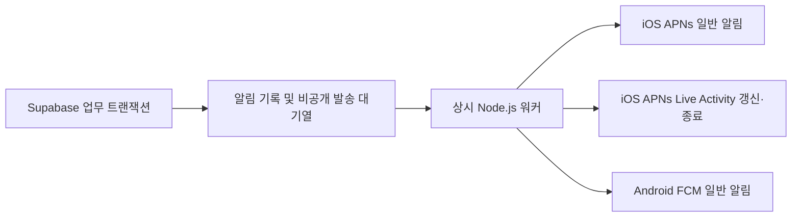

# 원격 알림과 Live Activities

회원·주문·채팅·알림 원본은 Supabase에 유지하고, iOS에는 APNs로 직접 전송합니다.
Android는 승인된 구조에 따라 Firebase Cloud Messaging(FCM)만 사용합니다.
Firebase Auth·Firestore·Analytics는 추가하지 않습니다.

앱·DB 마이그레이션·발송 워커 구현은 완료했고, 2026-10-16 운영 DB에 대기열과 RPC를
반영했습니다. **APNs/FCM 자격증명 연결, 상시 워커 배포, 서명된 실기기 수신 검증은
별도로 필요합니다.** 현재 실제 원격 알림 발송은 운영에 연결되지 않았습니다.
로컬 체험 모드와 웹에는 원격 알림을 제공하지 않습니다.

## 전송 흐름



- 업무 저장과 발송 대기열 생성은 같은 PostgreSQL 트랜잭션에서 처리합니다.
- 워커는 `LISTEN saip_push` 신호로 즉시 조회하며, 항상 1초 간격 재조회도 수행합니다.
  DB 직접 연결이 없어도 재조회 방식으로 작동합니다. 1초는 조회 주기이며 수신 보장 시간이 아닙니다.
- 앱이 전경이면 OS 배너를 억제하고 기존 Realtime 알림함·배지를 사용합니다.
  백그라운드 알림을 누르면 계정·기기 연결을 확인하고 최신 서버 데이터를 조회해 해당 화면을 엽니다.
- 앱 복귀 시에도 서버를 조회합니다. 푸시는 업무 데이터의 유일한 저장소가 아닙니다.

## iOS

`Runner/PushNotifications.swift`가 APNs 등록·권한·알림 탭을 처리하고 Flutter와
`agent_uncle/notifications` 채널로 통신합니다. 일반 알림은 iOS 15 이상,
Live Activities는 iOS 16.1 이상을 대상으로 합니다.

알림 설정에서 **잠금화면에서 사입 진행 보기**를 켜고, 수락된 주문 상세에서
**잠금화면에서 진행 보기**를 누르면 Live Activity가 시작됩니다. 현재는 앱 내 수동 시작이며
서버에서 새 활동을 시작하는 push-to-start는 구현하지 않았습니다.

`SaipLiveActivity` 확장은 현재 단계와 확보 수량을 잠금화면에 표시하고,
지원 기기에는 Dynamic Island의 compact·minimal·expanded 표시를 제공합니다.
iPhone 12 mini에서는 잠금화면으로 확인합니다. 위치나 예상 도착 시간은 생성하지 않습니다.
주문 종료·취소·접근 권한 상실 또는 설정 해제에 따라 활동을 종료합니다.

일반 알림과 활동 종료는 APNs priority 10, 일반 진행 갱신은 priority 5로 전송합니다.
진행 갱신은 별도 소리·배너를 만들지 않습니다. priority 5는 고우선순위 갱신 예산 소진을
피하지만 표시가 지연될 수 있습니다. 활동은 최대 8시간이며, 갱신 후 15분이 지나면
오래된 상태로 표시합니다(iOS 16.2 이상). 시스템 제한과 사용자의 활동 허용 설정이 우선합니다.

### Apple 설정

1. Apple Developer에서 앱 ID `com.hanbatco.agentUncle`의 Push Notifications를 활성화합니다.
2. Xcode의 `Runner`와 `SaipLiveActivity` 대상에 같은 팀과 올바른 프로비저닝을 적용합니다.
   확장 ID는 `com.hanbatco.agentUncle.SaipLiveActivity`입니다. 앱에는
   `Runner.entitlements`와 `NSSupportsLiveActivities`가 설정되어 있습니다.
3. APNs 인증 키 `.p8`, Key ID, Team ID를 서버 secret으로 준비합니다.
   인증 키는 앱 번들이나 저장소에 넣지 않습니다.
4. 현재 빌드 설정은 Debug=`development`, Release/Profile=`production`입니다.
   실제 서명 entitlements의 `aps-environment`와 일치해야 합니다.
   TestFlight/App Store는 production APNs를 사용합니다.
5. 워커의 `APNS_BUNDLE_ID`는 위 앱 ID로 지정합니다. Live Activity topic의
   `.push-type.liveactivity` 접미사는 워커가 붙입니다. 확장 ID를 넣지 않습니다.

## Android

Kotlin `PushNotifications.kt`가 FCM data 메시지를 받아 일반 시스템 알림을 표시합니다.
`firebase-messaging` 의존성만 추가했으며 자동 초기화는 로그인 연결 시 제어합니다.
Android 13 이상은 `POST_NOTIFICATIONS` 권한을 요청합니다. 알림 채널은
사입 업무·새 메시지·거래처 연결로 나뉘며, OS 설정에서 소리·표시를 조절할 수 있습니다.

FCM은 HIGH priority data-only 메시지를 전송하고 앱이 표시를 담당합니다.
같은 전송 ID를 중복 표시하지 않으며, 잠금화면 공개 범위는 PRIVATE입니다.
현재 small icon은 Android 기본 정보 아이콘을 사용합니다.

### Firebase 설정

1. Firebase 프로젝트에 Android 앱 `com.hanbatco.agent_uncle`을 등록합니다.
2. 해당 앱의 `google-services.json`을 `android/app/google-services.json`에 둡니다.
   Gradle이 패키지명에 맞는 항목을 읽어 필요한 리소스를 생성합니다. 이 파일은 gitignored입니다.
   파일이 없어도 개발 빌드는 가능하지만 FCM 등록·수신은 활성화되지 않습니다.
3. 해당 프로젝트에서 Firebase Cloud Messaging API(HTTP v1)를 활성화합니다.
4. 서버 발송 계정에 대상 프로젝트의 `cloudmessaging.messages.create` 권한을 부여합니다.
   공식 사전 정의 역할은 `roles/firebasecloudmessaging.admin`입니다.
5. 서버용 서비스 계정 JSON을 secret 파일로 준비하고 워커의
   `GOOGLE_APPLICATION_CREDENTIALS`로 지정합니다. 앱의 `google-services.json`과 다른 파일입니다.
   서비스 계정 JSON은 앱·저장소에 포함하지 않습니다.

현재 워커는 서비스 계정 JSON의 키로 OAuth 토큰을 직접 발급합니다. 메타데이터 서버나
Workload Identity 기반 ADC 탐색은 구현하지 않았습니다. Android 앱 설정과 서비스 계정의
`project_id`는 같은 발송 프로젝트를 가리켜야 합니다. Google Play services 지원 기기가 대상입니다.

## DB와 워커 운영

`supabase/migrations/202610150006_push_notifications.sql`에는 비공개 기기·활동·발송 대기열과
RPC가 있습니다. 앞선 계정 탈퇴·차단·업무 권한·정산·팀·편의 기능·업무 projection에 의존하므로
이 파일만 단독으로 적용하지 않습니다. 대상 프로젝트와 누적 마이그레이션을 먼저 확인합니다.

2026-10-16 선행·후속 마이그레이션과 함께 운영 DB에 적용했습니다. 공유 운영 DB에는
랜딩·백오피스의 외부 이력도 있으므로, 후속 배포는
[공유 DB 이력 처리](supabase.md#공유-db의-마이그레이션-이력-처리)를 따르고 dry-run 목록을
확인합니다. 발송 워커는 DB 배포와 별개입니다.

`server/push-worker/`는 Node.js 22 이상에서 상시 실행하는 프로세스입니다.
앱의 Supabase 클라이언트와 별도로 배포해야 합니다. 환경변수 예시는
[`server/push-worker/.env.example`](../server/push-worker/.env.example)에 있습니다.

| 변수 | 용도 |
| --- | --- |
| `SUPABASE_URL` | 앱과 같은 프로젝트 URL |
| `SUPABASE_SERVICE_ROLE_KEY` | 워커 전용 서버 서비스 키 |
| `DATABASE_URL` | 선택: PostgreSQL 직접 연결 또는 session pooler의 LISTEN 연결 |
| `APNS_KEY_PATH` | 서버의 `.p8` 파일 경로 |
| `APNS_KEY_ID` / `APNS_TEAM_ID` | APNs 인증 키 ID / Apple 팀 ID |
| `APNS_BUNDLE_ID` | `com.hanbatco.agentUncle` |
| `GOOGLE_APPLICATION_CREDENTIALS` | 서버 서비스 계정 JSON 경로 |

`APNS_PRIVATE_KEY` 환경변수도 지원하지만 파일 마운트를 권장합니다.
`DATABASE_URL`에 transaction pooler를 사용하지 않습니다. LISTEN 연결에 실패하거나
연결이 끊겨도 1초 재조회는 유지됩니다. 현재 LISTEN 자동 재연결은 없으므로 연결 복구 후
워커를 재시작합니다. 두 공급자의 필수 설정을 시작 시 검사합니다.

```sh
cd server/push-worker
npm ci
node --env-file=/secure/path/push-worker.env worker.mjs
```

저장소 루트에서 컨테이너로 실행할 수도 있습니다.

```sh
docker build -t saip-push-worker server/push-worker
docker run -d --name saip-push-worker --restart unless-stopped \
  --env-file /secure/path/push-worker.env \
  --mount type=bind,src=/secure/path/apns.p8,dst=/run/secrets/apns.p8,readonly \
  --mount type=bind,src=/secure/path/fcm-service-account.json,dst=/run/secrets/fcm-service-account.json,readonly \
  saip-push-worker
```

컨테이너는 `node` 사용자로 실행합니다. 해당 사용자의 secret 읽기 권한과 Supabase·APNs·Google
API로의 외부 통신을 허용합니다. sleep 상태가 되는 서버나 주기적 cron만으로 운영하지 않습니다.

## 재시도·계정 보호

- 기기·활동 토큰은 `saip_private` 테이블에만 저장하며 앱에서 열람할 수 없습니다.
- 기기 등록은 인증된 계정·유효 세션을 확인합니다. 발송 claim 시에도 계정·세션·기기 binding,
  수신 설정·읽음·차단·업무 접근 권한을 재확인합니다.
- 로그아웃·계정 전환 시 네이티브 연결과 표시 중 알림을 정리하고 서버 등록을 해제합니다.
  기기에 이미 전달되었거나 전송 중인 모든 iOS 알림을 회수한다고 보장하지 않습니다.
  이전 계정 알림을 눌러도 새 계정에서 그 화면을 열지 않도록 검사합니다.
- Live Activity 토큰 교체에는 Keychain의 임의 secret을 사용합니다. 서버는 해시로 검증하고,
  인증된 앱에서 미리 준비한 활동에만 토큰을 등록합니다. 로그인·갱신 토큰을 네이티브에 복제하지 않습니다.
- 일반 푸시 본문에는 채팅 원문·상품 주소를 넣지 않고 새 소식이 있다는 안내와 목적지 ID만 보냅니다.
- 기기별 발송을 직렬화하고 60초 lease로 장애 후 재처리합니다. 최대 8회 재시도하며 지수 backoff와
  공급자 오류 분류를 적용합니다. 일반 작업 TTL은 24시간, 활동 갱신은 활동 수명에 맞추며
  종료 처리를 위한 일부 작업에는 1시간 여유를 둡니다. 무효 토큰은 비활성화합니다.
- 활동 payload는 claim 시 최신 상태로 만들고 timestamp를 증가시킵니다.
  네트워크 응답 유실에 따른 재전송까지 exactly-once 표시를 보장하지 않습니다.
- 매시간 완료·건너뜀·실패 작업 중 30일 지난 기록, 활동 만료 후 2일 지난 기록,
  90일간 갱신되지 않았거나 세션이 무효인 기기를 정리합니다.

## 운영 확인

워커 로그에는 작업 ID·공급자 접수 결과·오류 코드만 남기며 토큰·본문·비밀키는 출력하지 않습니다.
`accepted`는 **APNs/FCM 접수**를 뜻하며 실제 단말 수신·화면 표시 성공은 아닙니다.
관리자 SQL 콘솔에서 토큰을 출력하지 않고 대기 시간과 오류를 확인할 수 있습니다.

```sql
select state, count(*), min(created_at) as oldest_created_at
from saip_private.push_outbox group by state;

select last_error, count(*)
from saip_private.push_outbox
where state = 'dead' and created_at > now() - interval '24 hours'
group by last_error;

select extract(epoch from now() - min(created_at)) as oldest_pending_seconds
from saip_private.push_outbox where state = 'pending';
```

운영 모니터링에서 워커 생존, 오래된 pending/sending, dead 증가를 감시합니다.
`push_cycle_failed`, 인증 오류, APNs 환경 불일치가 지속되면 설정·네트워크를 확인합니다.
실패 작업을 무조건 되살리지 말고 만료·권한·중복 가능성을 확인합니다.

## 검증과 실기기 확인

로컬 검증은 TDS 정책, Flutter 알림 테스트, 워커 테스트, 별도 로컬 DB의 pgTAP,
Android debug 빌드, iOS 서명 없는 release 빌드로 수행했습니다. 에뮬레이터·시뮬레이터는
실행하지 않았습니다. 빌드 성공은 APNs 서명·운영 자격증명·단말 도착 검증을 대신하지 않습니다.

```sh
dart tool/tds_guard/tds_guard.dart check
flutter analyze --no-pub
flutter test --no-pub test/remote/push_notifications_test.dart test/local/push_destination_test.dart
npm --prefix server/push-worker test
```

DB 검증 파일은 `supabase/tests/push_notifications_test.sql`입니다. 운영 DB에서 실행하지 않고
누적 마이그레이션이 적용된 격리된 로컬 DB에 실행합니다.

사용자가 실기기에서 확인할 항목:

1. 소매업자·삼촌으로 로그인하고 허용/거부/재허용 시 설정 상태를 확인합니다.
2. 전경·백그라운드·일반 종료 상태에서 새 요청·채팅·연결·전달 알림을 확인합니다.
3. 알림을 연속으로 누르거나 로그아웃·계정 전환 후 눌렀을 때 올바른 계정의 화면만 여는지 확인합니다.
4. iOS에서 주문 상세로 활동을 시작하고 확보·전달·수령·취소에 따라 갱신·종료되는지 확인합니다.
   iPhone 12 mini는 잠금화면, Dynamic Island는 지원 기기를 사용합니다.
5. 수신 설정 해제·채팅 차단·계정 탈퇴·토큰 교체·오프라인 후 복귀 상황을 확인합니다.
6. 워커 중단·재시작 시 만료되지 않은 대기 작업이 복구되고 오류가 기록되는지 확인합니다.

알림 차단·집중 모드·오프라인·Doze·제조사 절전·Android 강제 중지 등은 수신과 표시를 제한합니다.
Android 강제 중지는 앱을 다시 열기 전까지 수신을 막을 수 있습니다. 모든 상황에서 즉시 도착하거나
Live Activity가 매번 갱신된다고 보장하지 않습니다.

## 공식 참고 문서

- [Apple APNs 서버 구성](https://developer.apple.com/documentation/usernotifications/setting-up-a-remote-notification-server)
- [Apple Live Activity 원격 갱신·종료와 우선순위](https://developer.apple.com/documentation/activitykit/starting-and-updating-live-activities-with-activitykit-push-notifications)
- [Android Doze와 FCM 우선순위](https://developer.android.com/training/monitoring-device-state/doze-standby)
- [Firebase Android FCM 설정](https://firebase.google.com/docs/cloud-messaging/android/get-started)
- [Firebase HTTP v1 전송 인증](https://firebase.google.com/docs/cloud-messaging/send/v1-api)
- [Firebase IAM 역할](https://firebase.google.com/docs/projects/iam/roles-predefined-product)
